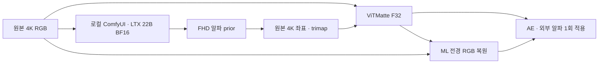

# LTX-2.5 Roto Workflow

로컬 ComfyUI API로 LTX-2.5 Alpha Gen을 실행하고, 원본 4K 영상에서 머리카락 알파와 전경 색을 보정한 뒤 After Effects의 편집 가능한 알파 매트로 연결하는 워크플로입니다.

이번 검증 구성은 **LTX-2.5 22B BF16 FHD 알파 → 원본 4K ViTMatte FLOAT32 정밀화 → ML 전경 RGB 복원 → AE 32bpc 합성**입니다. LTX 자체를 4K로 추론한 결과라고 표기하지 않습니다. ComfyUI MCP나 클라우드 추론 없이 로컬 API를 사용합니다.

## 사용 순서

Python 3.11 이상을 사용하고, 아래 문서의 명령은 저장소 루트에서 실행합니다. 실제 검증 환경 버전은 `config/runtime-versions.json`에 기록했습니다.

1. 로컬 ComfyUI와 필요한 LTX 노드를 준비하고, 공식 모델을 자신의 SSD에 다운로드합니다. 모델 접근 동의와 인증은 자신의 Hugging Face 계정에서 진행합니다.
2. [파이프라인 사용법](docs/pipeline.md)에 따라 로컬 경로를 설정하고 입력 구간을 준비합니다. 먼저 준비 단계의 프레임 수와 타임스탬프를 확인한 뒤 API에 한 번 제출합니다.
3. 원본 RGB와 LTX prior를 사용해 4K 알파 및 RGB-only 전경을 생성합니다. 원래 LTX 알파도 별도로 보존합니다.
4. [After Effects 연결](docs/after-effects.md)에 따라 새 프로젝트를 만들고 입력 해석·알파 적용·실제 출력값을 검증합니다.
5. 검정·회색·흰색·대비색 배경과 1:1 모발 화면에서 전체 구간을 확인합니다. [브레이크다운 구성](docs/breakdown.md)은 별도로 정리했습니다.

## 포함된 것

| 경로 | 내용 |
|---|---|
| `pipeline/` | 로컬 API 및 알파·전경 처리 코드 |
| `workflows/` | ComfyUI 워크플로와 의존 노드 정보 |
| `config/` | 개인 경로를 넣기 전의 예제 설정 |
| `ae/` | AE JSX·준비·출력 검증 도구 |
| `docs/` | 실행 절차, 검증 범위, 브레이크다운 규격 |
| `tests/` | 중복 제출과 데이터 계약에 대한 작은 회귀 검증 |

모델·원본 영상·EXR·AEP·렌더 영상은 로컬 작업 폴더에 둡니다. 이 저장소에는 코드와 작은 설정·문서만 포함합니다. 결과 파일을 Git에 추가하는 대신 실행 폴더의 프레임 ledger와 SHA 기록으로 추적합니다.

## 검증한 범위

Windows, RTX 4070 Ti SUPER 16GB, RAM 32GB에서 바람에 날리는 모발 예제 **65프레임 / 25fps / 2.6초**를 처리했습니다. 원본은 4096×2160이며 원본 프레임 75–139를 사용했습니다.

- 원본·알파·전경·원래 prior의 총 260개 파일을 SHA, 프레임 번호, 채널 형식으로 확인했습니다.
- 실제 AE 출력 100개를 검증했습니다. 전체 65프레임의 알파는 F32 비트 단위로 일치했고, 전경 RGB×알파 비교의 최대 오차도 0이었습니다.
- 원본 RGB8와 독립 전경 입력 보존 검사는 5개 표본입니다. 이 표본 검사를 전체 65프레임의 독립 입력 검사로 확대해 표현하지 않습니다.
- 전 구간 모발·몸통·타일 경계를 검수했으며, 약한 잔머리와 원본 모션 블러의 한계는 남습니다. 수치 일치는 모든 영상에서의 로토 품질 보장이 아닙니다.

실제 로컬 작업의 검증과, 이 저장소로 옮긴 코드의 검증을 구분합니다. 재정리된 복사본 때문에 GPU 추론이나 AE 렌더를 다시 돌리지는 않았습니다. 세부 범위는 [검증 기록](docs/results.md)을 참고하세요.

## 반드시 유지할 데이터 계약

- F32 알파와 RGB-only 전경을 분리합니다. AE에서 외부 알파를 두 번 곱하지 않습니다.
- 복원 전경은 BT.709 **coded RGB** 값입니다. AE 입력의 `Preserve RGB`와 출력 색상 변환 설정을 확인합니다. 임의의 scene-linear 해석을 추가하면 밝기와 색이 달라집니다.
- 4K 정밀화의 trimap erosion은 확실한 전경·배경 seed를 만드는 용도입니다. 최종 알파를 깎거나 흐리게 만드는 효과가 아닙니다.
- AE queue item마다 출력 폴더를 분리합니다. 파일 번호가 0부터 재시작할 수 있으므로 실제 source-frame mapping으로 최종 시퀀스를 조립합니다.
- 재시도 시 새 GPU 작업을 중복 제출하지 않습니다. UUID·완료 상태·기존 결과를 먼저 확인합니다.

모델·의존 라이브러리·예제 영상의 출처와 이용 조건은 [THIRD_PARTY_NOTICES.md](THIRD_PARTY_NOTICES.md)에 있습니다.
